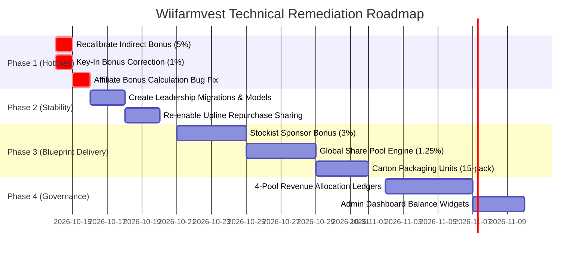

# WIIFARMVEST TECHNICAL REMEDIATION & IMPLEMENTATION ACTION PLAN
**Target System:** Wiifarmvest Platform (Wiifarm Cooperative Society of Nigeria)  
**Reference Document:** Compensation Engineering Blueprint (Version 1.0) & Executive Audit Report  
**Goal:** Complete remediation of financial leakage, code defects, missing models, and blueprint compliance gaps.

---

## 1. Executive Summary & Implementation Roadmap

| Phase | Focus Area | Timeline | Risk Level | Primary Impact |
|---|---|---|---|---|
| **Phase 1** | Immediate Financial Risk & Calculation Hotfixes | Day 1 – 2 | Critical | **COMPLETED:** Recalibrated Indirect (5%), Key-In (1%), & fixed Affiliate bonus |
| **Phase 2** | Code Stability & Missing Models | Week 1 | High | **COMPLETED:** Created Leadership models, migrations, & restored repurchase sharing |
| **Phase 3** | Blueprint Compensation Feature Delivery | Weeks 2 – 3 | Medium | Implements 3% Stockist Sponsor, 1.25% Global Share, & Carton wholesale units |
| **Phase 4** | Financial Governance & Pool Ledgers | Weeks 3 – 4 | Medium | Automates 4-pool revenue segregation & payout clearance |

---

## 2. Phase 1: Immediate Financial & Calculation Hotfixes (Day 1 – 2)

### Task 1.1: Recalibrate Indirect Referral Commission (CRP Budget Alignment)
* **Target File:** `core/app/Http/Helpers/helpers.php` (Lines 2315–2358: `indirectBonus()`)
* **Problem:** The system pays 13.0% total across 5 tiers (`0.06`, `0.03`, `0.02`, `0.01`, `0.01`). The Blueprint strictly limits this obligation to **5.00%**.
* **Action:**
  1. Recalibrate the 5 upline tier multipliers:
     * Tier 1 (Direct sponsor of sponsor): **2.00%** (`$pv * 0.02`)
     * Tier 2: **1.00%** (`$pv * 0.01`)
     * Tier 3: **1.00%** (`$pv * 0.01`)
     * Tier 4: **0.50%** (`$pv * 0.005`)
     * Tier 5: **0.50%** (`$pv * 0.005`)
     * **Total = 5.00%**
  2. Maintain existing transaction logging (`newTransaction()`) and user wallet increment.
* **Verification & Testing:**
  * Simulate a registration of a 450 PV package (`450 * ₦600 = ₦270,000`).
  * Verify Tier 1 receives `₦5,400` (2%), Tier 2 receives `₦2,700` (1%), Tier 3 receives `₦2,700` (1%), Tier 4 receives `₦1,350` (0.5%), and Tier 5 receives `₦1,350` (0.5%).
  * Total indirect bonus disbursed must equal exactly `₦13,500` (5%) instead of the previous `₦35,100` (13%).

### Task 1.2: Correct Registration Key-In Bonus (CRP Budget Alignment)
* **Target File:** `core/app/Http/Controllers/User/DistributorController.php` (Lines 296–312)
* **Problem:** The calculation hardcodes a 2% rate: `round(($pv * 0.02 * 600), 2)`. The Blueprint budget is **1.00%**.
* **Action:**
  1. Change multiplier from `0.02` to `0.01`:
     ```php
     $keyInBonus = round(($pv * 0.01 * 600), 2);
     ```
  2. Update inline comments and documentation in the controller.
* **Verification & Testing:**
  * Simulate a distributor registration on 450 PV.
  * Verify the sponsoring operator's `key_in_bonus` wallet is credited with `₦2,700` (1%) instead of `₦5,400` (2%).

### Task 1.3: Fix Affiliate Store Commission Miscalculation (Bug Fix)
* **Target File:** `core/app/Services/AffiliateOrderService.php` (Lines 179–185)
* **Problem:** During fulfillment, `creditAffiliateBonus()` sums `($item->product?->affiliate_bonus_value ?? 0) * $item->quantity`. For percentage-based bonuses, `affiliate_bonus_value` represents the percentage number (e.g. `10`), crediting ₦10 instead of 10% of order value.
* **Action:**
  1. Modify line 180–182 to sum the already computed and stored `bonus_amount` column from `order_items`:
     ```php
     $total = (float) $order->items->sum('bonus_amount');
     ```
  2. Verify that orders with multiple items aggregate correctly.
* **Verification & Testing:**
  * Create a test affiliate order with a ₦50,000 product offering a 10% affiliate commission.
  * Trigger pickup/completion.
  * Verify the affiliate's wallet is credited with `₦5,000` rather than `₦10`.

---

## 3. Phase 2: System Stability & Model Restoration (Week 1)

### Task 2.1: Create Leadership Bonus Database Migrations
* **Target Directory:** `core/database/migrations/`
* **Problem:** `LeadershipBonusService.php` references `leadership_settings`, `leadership_leaders`, and `leadership_bonus_logs`, but none of these tables exist.
* **Action:**
  1. Create migration `create_leadership_tables.php`:
     * Table `leadership_settings`: `id`, `required_pv` (decimal 12,2), `percentage` (decimal 5,2), `max_levels` (int), `is_active` (boolean), `enabled_at` (timestamp), `timestamps`.
     * Table `leadership_leaders`: `id`, `user_id` (foreign key), `pv_left` (decimal 12,2), `pv_right` (decimal 12,2), `required_pv` (decimal 12,2), `status` (boolean), `qualified_at` (timestamp), `notified_at` (timestamp, nullable), `timestamps`, unique index on `user_id`.
     * Table `leadership_bonus_logs`: `id`, `leader_id` (foreign key to users), `source_user_id` (foreign key to users), `matching_bonus_log_id` (foreign key), `level` (int), `leg` (string, nullable), `matching_amount` (decimal 12,2), `percentage` (decimal 5,2), `amount` (decimal 12,2), `trx` (string 40), `timestamps`.
  2. Run `php artisan migrate`.
  3. Seed initial default setting in `leadership_settings`: `required_pv = 1000`, `percentage = 4.00`, `max_levels = 5`, `is_active = true`, `enabled_at = now()`.

### Task 2.2: Implement Missing Eloquent Models
* **Target Directory:** `core/app/Models/`
* **Action:**
  1. Create `core/app/Models/LeadershipSetting.php`:
     * Implement `current()` singleton getter (caching active settings).
     * Implement `isActive()`, `percentageLabel()`, and `levelsLabel()`.
  2. Create `core/app/Models/LeadershipLeader.php`:
     * Define casts, relationships (`user()`), and `scopeActive()`.
  3. Create `core/app/Models/LeadershipBonusLog.php`:
     * Define fillables, relationships (`leader()`, `sourceUser()`, `matchingLog()`).
* **Verification & Testing:**
  * Run `php artisan tinker`:
    * Execute `App\Models\LeadershipSetting::current()`.
    * Verify no ClassNotFound exceptions occur.
    * Trigger a test run of `LeadershipBonusService::processPending()` and confirm clean execution.

### Task 2.3: Re-Enable Upline Repurchase Volume Sharing
* **Target File:** `core/app/Http/Controllers/User/StockistController.php` (Lines 482–489 & Lines 606–636)
* **Problem:** Repurchase PV upline distribution (`shareRepurchasePvUpline`) was commented out/bypassed.
* **Action:**
  1. Remove comment on line 608 (which had an erroneous recursive self-call).
  2. At line 488 within the product redemption loop, invoke `$this->shareRepurchasePvUpline($user_dist, $product->pv * $quantity);`.
  3. Verify matrix traversal respects `MAX_UPLINE_PV_LEVELS` and logs appropriately to `pv_logs` table.
* **Verification & Testing:**
  * Perform a product invoice redemption at a stockist for an active member.
  * Verify the member's upline binary nodes receive repurchase PV allocated to the proper Left/Right leg.

---

## 4. Phase 3: Blueprint Compensation Feature Delivery (Weeks 2 – 3)

### Task 3.1: Implement Stockist Sponsor Override Bonus (3.00%)
* **Problem:** The Commerce Pool reserves 3.00% for members who sponsor stockists, but stockists currently have no link to an introducer.
* **Action:**
  1. **Database Migration:** Add `sponsor_user_id` (nullable foreign key to users) on `stockists` table.
  2. **Model Relationship:** Add `sponsor()` relationship to `App\Models\Stockist`.
  3. **Admin Onboarding UI:** Add "Sponsoring Distributor" input field when approving or creating a Mega or Micro stockist.
  4. **Commission Service:** Create `StockistCommissionService.php`:
     * When stockist product orders or warehouse restocks are approved, calculate 3.00% of order PV value (`pv * 0.03 * 600`).
     * Credit the sponsoring distributor's wallet and create an audit transaction entry.
* **Verification & Testing:**
  * Create a test stockist assigned to Sponsor A.
  * Complete a ₦500,000 stock purchase (e.g. 500 PV).
  * Confirm Sponsor A receives `₦9,000` (`500 * 0.03 * 600`) as a Stockist Sponsorship Bonus.

### Task 3.2: Implement Global Share Pool Engine (1.25%)
* **Problem:** 1.25% of strategic revenue is reserved for high-ranking global leaders, but no engine exists to accrue or pay this pool.
* **Action:**
  1. **Ledger Table:** Create `global_pool_ledgers` (`period`, `accumulated_amount`, `distributed_amount`, `status`).
  2. **Accumulation Hook:** On every product invoice and registration completion, credit 1.25% of PV value into the active pool balance.
  3. **Quarterly Distribution Job:** Create `ProcessGlobalSharePoolJob.php`:
     * Query all users achieving target rank awards (e.g., Diamond Director and above).
     * Divide the period pool equally or weighted by rank shares.
     * Disburse funds into the users' strategic wallets.
* **Verification & Testing:**
  * Accumulate mock transactions; run `artisan pool:distribute --quarter=Q4-2026`.
  * Confirm exact penny balance match without pool overdraft.

### Task 3.3: Implement Wholesale Carton Unit Standardization
* **Problem:** Inventory and ordering only recognize unit pieces, ignoring the blueprint's standard 15-pack carton requirement.
* **Action:**
  1. Add `carton_size` (default: 15) and `price_per_carton` to `products` table.
  2. Update stockist inventory ordering forms to allow selection between "Individual Packs" and "Wholesale Cartons (15 Packs)".
  3. Ensure stock deduction accurately decrements `quantity_cartons * 15` in warehouse inventory.

---

## 5. Phase 4: Financial Governance & Pool Segregation (Weeks 3 – 4)

### Task 4.1: Implement Automated Pool Ledger Architecture
* **Blueprint Requirement:** Revenue must be strictly segregated:
  * **30.00%** Company Reserve Pool
  * **10.00%** Executive Pool
  * **5.00%** Operational Pool
  * **55.00%** Member Compensation Reserve
* **Action:**
  1. Create `company_pool_ledgers` table to track running balances of all 4 pools.
  2. Implement `RevenueAllocationService.php`.
  3. Intercept every incoming financial gateway event (Paystack, manual deposit, wallet debit) to allocate splits atomically in the database:
     * When ₦100,000 is received:
       * ₦30,000 &rarr; Company Reserve
       * ₦10,000 &rarr; Executive Pool
       * ₦5,000 &rarr; Operational Expenses
       * ₦55,000 &rarr; Member Compensation Reserve
  4. Build an Admin Dashboard overview widget displaying real-time balances of the 4 pools.

### Task 4.2: Enforce Payout Clearance against Pool Balances
* **Action:**
  * When bonus dispatch jobs (Binary matching, unilevel, awards) run, verify that the `Member Compensation Reserve` holds sufficient accrued margin.
  * Disallow bonus execution if reserve balance is deficient, generating an alert for financial administrators.

---

## 6. Implementation Schedule & Resource Allocation



---

## 7. Pre-Deployment & Rollback Strategy

1. **Pre-Deployment Database Backup:**
   * Full snapshot of MySQL database prior to executing Phase 1 and Phase 2 migrations.
2. **Feature Flags:**
   * Wrap new commission distributions (Stockist Sponsor and Global Share) in system settings toggles (`gs()->stockist_sponsor_status`).
3. **Rollback Procedures:**
   * All database modifications must feature paired `down()` migration methods.
   * Maintain tagged git release commits for each phase boundary (`v1.1-phase1-hotfix`, `v1.2-phase2-stability`).
